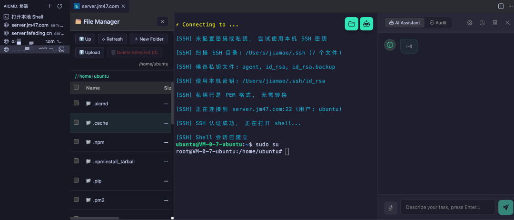
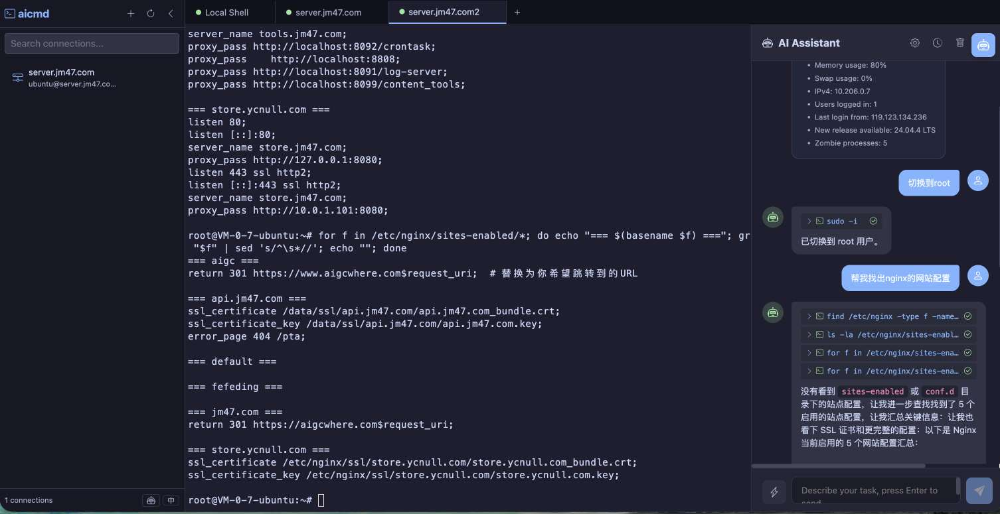

# AICmd

**[中文文档](./README.zh.md)**

An AI-powered web SSH terminal that combines a full-featured terminal emulator with an autonomous AI agent. The AI understands your system environment, executes commands, analyzes logs, manages services — all through natural language conversation.

## Features

### AI Agent
- **Autonomous Operation**: AI agent directly executes commands in the terminal via tool calling (OpenAI function calling protocol). It observes output, makes decisions, and iterates until the task is done.
- **System Awareness**: Automatically detects OS, CPU, memory, disk, installed services, and available languages on first connection. The AI always knows what system it's working with.
- **Language Adaptation**: AI automatically responds in the same language as the user's message. Falls back to the UI locale when the message language is ambiguous.
- **Script Generation**: For complex multi-step tasks, the agent generates and executes scripts (Bash/Python/PowerShell) instead of running commands one by one.
- **Cross-Platform Intelligence**: Adapts commands based on target OS — uses `systemctl` on Linux, `launchctl` on macOS, `Get-Service` on Windows.

### Skills System
- **Built-in Skills**: Pre-configured operational playbooks for common tasks:
  - Server Health Check — comprehensive system metrics collection
  - Log Analysis — error pattern detection with Python/awk scripts
  - Docker Management — container lifecycle operations
- **Custom Skills**: Create your own skills as markdown files in `~/.aicmd/skills/`. Skills define domain-specific SOPs, project-specific knowledge, or any workflow the LLM doesn't already know.
- **Slash Commands**: Trigger skills with `/skill-name` in the chat input.

### Command Audit & Replay
- **Full Audit Trail**: Every command executed by the AI agent is automatically recorded with timestamp, session, command, output, duration, and status (success/error/blocked/rewritten).
- **Timeline View**: Browse audit logs by date with keyword search and status filtering.
- **Statistics Dashboard**: Overview of total commands, success/error/blocked counts.
- **Export**: Export audit logs as JSON or CSV for compliance and incident review.
- **Real-time Updates**: New audit entries appear instantly in the Audit panel via WebSocket.
- **Auto Cleanup**: Logs older than 30 days are automatically purged.

### Real-time Log Monitoring + AI Anomaly Detection
- **One-Click Tail**: Monitor any log file (`tail -f`) on remote SSH servers or local machine.
- **Pattern Detection**: Automatically detects ERROR, FATAL, CRITICAL, Exception, Traceback, and other anomaly patterns.
- **Alert System**: Categorized alerts (critical/error/warning) with timestamps and highlighted log lines.
- **AI Analysis**: Send recent log lines to the AI agent for intelligent anomaly analysis and recommendations.
- **Color-Coded Output**: Error lines in red, warnings in yellow, debug in dimmed — easy to scan.

### Batch Operations (Multi-Server)
- **Parallel Execution**: Select multiple active SSH sessions and execute the same command on all of them simultaneously.
- **Aggregated Results**: View per-server results with success/failure status, output, and execution time.
- **Server Selector**: Multi-select UI with Select All / Clear options, showing session names and connection types.
- **Expandable Details**: Click any result to see full command output, with copy-to-clipboard support.
- **Task History**: Recent batch tasks are stored for review.

### Jump Host & SSH Agent Forwarding
- **Startup Script**: Configure a per-connection script that runs automatically after SSH login — ideal for jump host scenarios (e.g., `ssh target-server` to hop to the final destination).
- **SSH Agent Forwarding**: Forward your local SSH agent to the remote server, enabling key-based authentication for subsequent SSH hops without storing keys on intermediate servers.
- **Auto-Detection**: Automatically detects the local SSH agent socket (`SSH_AUTH_SOCK` on Linux/macOS, OpenSSH agent pipe on Windows).
- **Smart System Info**: For jump host sessions, system information is actively collected from the target server (not the jump host) when the AI needs it.
- See [Jump Host Guide](./docs/jump-host.md) for detailed setup instructions.

### Terminal
- **SSH Remote Terminal**: Full SSH client based on xterm.js + ssh2 with 256-color support.
- **Local Shell**: Native local shell via node-pty (Bash/Zsh on macOS/Linux, PowerShell on Windows).
- **File Transfer**: rz/sz (ZMODEM) file upload and download with automatic binary handling.
- **Multi-Session**: Tab-based multi-session management with persistent state across restarts.
- **Auto-Reconnect**: One-click reconnection for dropped SSH sessions.
- **Session Persistence**: All sessions and chat history are persisted on the server side.
- **Adaptive Layout**: Terminal automatically resizes when the AI chat panel is toggled, maintaining proper column count.

### General
- **Connection Management**: Visual SSH / RDP connection configuration (CRUD) with key-based, password, and auto auth. The editor shows only required fields by default; group / tags, platform, startup scripts, port forwards, keepalive, terminal appearance and proxy settings live in collapsible sections and auto-expand when already configured.
- **Connection Grouping & Search**: The sidebar tree collapses connections by **group** or **tag**; search covers name, host, username, group and tags. Set group / tags in the connection editor.
- **Connection Backup & Sharing**: Export connections to JSON (secrets omitted by default for team sharing; include passwords / keys explicitly for personal backups). Import overwrites same-name connections and reports added / updated / skipped counts.
- **Connection Proxy**: Per-connection direct / system / custom proxy (HTTP, HTTPS, SOCKS4, SOCKS5) for SSH and RDP, including automatic OS proxy detection and bypass rules. See [Proxy Guide](./docs/proxy.md).
- **i18n**: Chinese / English UI with runtime language switching.
- **Desktop App**: Cross-platform desktop client via Electron (Windows, macOS, Linux).
- **Chat History**: Persistent AI conversation history with browsing and restoration across sessions.
- **CI/CD**: Automated multi-platform builds via GitHub Actions — push a version tag to generate installers for all platforms.

## Screenshot

**VSCode Extension**



**Desktop / Web**



## Tech Stack

| Layer | Technology |
|-------|-----------|
| Frontend | Vue 3 + TypeScript + Vite + Bootstrap 5 + xterm.js |
| Backend | Node.js + Express + WebSocket (ws) |
| SSH/PTY | ssh2 + node-pty |
| RDP | IronRDP-WASM + RDCleanPath byte tunnel |
| AI | OpenAI-compatible API (supports any compatible endpoint) |
| Build | Vite + TypeScript + electron-builder |

## Quick Start

### Install

```bash
npm install -g @fefeding/aicmd
# or
pnpm add -g @fefeding/aicmd
```

### Requirements

- Node.js >= 18

### Start Server

```bash
# Start (default port 9802, auto-finds available port)
aicmd start

# Custom port
aicmd start --port 3000

# Stop / Restart
aicmd stop
aicmd restart

# Version
aicmd -v
```

Then open http://localhost:9802 in your browser.

### Configure AI

1. Click the robot icon (bottom-left sidebar) or the gear icon in the AI chat header.
2. Enter your API Key and base URL (supports OpenAI, DeepSeek, Qwen, or any compatible API).
3. Choose a model (default: `gpt-4o-mini`).
4. Save and start chatting.

### Development

```bash
# Clone and install
git clone <repo-url>
pnpm install

# Dev mode (with hot reload)
pnpm dev
# Visit http://localhost:9801

# Build
pnpm build          # Frontend + server
pnpm build-server   # Server only

# Start production
node server.js --port 3000
```

### Desktop App (Electron)

Pre-built installers are available from [GitHub Releases](https://github.com/fefeding/ai-cmd/releases), or build from source:

```bash
pnpm electron:dev          # Dev mode
pnpm electron:build        # Current platform
pnpm electron:build:win    # Windows (NSIS installer)
pnpm electron:build:mac    # macOS (DMG, x64 + arm64)
pnpm electron:build:linux  # Linux (AppImage)
```

### macOS 打开提示

CI 自动构建的 macOS 客户端**未使用 Apple Developer ID 签名公证**（无证书），下载后首次打开会提示“已损坏，无法打开”。这是 Gatekeeper 的 quarantine 拦截，并非文件损坏。解除拦截：

```bash
# 下载后执行，移除 quarantine 属性即可正常打开
xattr -cr /Applications/AICmd.app
```

如果你自己有 Developer ID 证书，可在本地直接 `pnpm electron:build:mac` 出已签名的版本（脚本会自动从 keychain 取证书）。

### Automated Builds (CI/CD)

Two tag prefixes trigger different workflows — push to the `github` remote (the `origin` mirror does not run Actions):

```bash
# Client installers only (Windows / macOS / Linux)
git tag v0.1.27
git push github v0.1.27

# Client installers + VSIX + GitHub Release + VS Code Marketplace + Open VSX
git tag aicmd-v0.1.27
git push github aicmd-v0.1.27
```

For `aicmd-v*` tags the version must match `packages/vscode/package.json`, otherwise CI fails. Or trigger manually from the **Actions** tab with platform selection.

### VSCode Extension

AICmd also ships as a VSCode extension that runs the **same** backend and front-end inside the editor — no separate install needed. It launches `server.js` as a child process (bound to `127.0.0.1`) and loads the SPA through a same-origin WebView iframe, so all features (SSH/local terminal, RDP remote desktop, AI Agent, skills, audit, log monitoring, batch ops, file transfer) work in-editor. Connection data is shared with the desktop/CLI via `~/.aicmd/connections.json`.

- **Install / build from source**: see [`packages/vscode/README.md`](./packages/vscode/README.md) for detailed setup, usage, settings, and packaging instructions.
- **Quick dev loop**:

```bash
pnpm build:vscode      # build front-end + backend + extension host
cd packages/vscode && npm run watch   # continuous extension rebuild
# then press F5 in VSCode to launch the Extension Development Host
```

- **Package**: `pnpm build:vscode && cd packages/vscode && vsce package` produces a `.vsix`.
- **Key settings**: `aicmd.dataDir` (data directory, default `~/.aicmd`), `aicmd.startPort` (starting port, default `9802`).
- **Commands**: `AICmd: 打开终端`, `AICmd: 搜索连接（名称 / 分组 / 标签）`, `AICmd: 连接分组方式（按分组 / 按标签）`, `AICmd: 导出连接 JSON`, `AICmd: 导入连接 JSON`, plus connection add / edit / delete / refresh in the Activity Bar's **AICmd → Connections** view. See the [extension usage guide](./packages/vscode/README.md).

## AI Usage Examples

### Natural Language Operations
```
You: Check if nginx is running and show recent error logs
AI: [executes systemctl status nginx, then reads error logs, provides analysis]

You: Find the top 5 processes consuming memory
AI: [generates and runs a ps/sort script, presents results as a table]

You: Clean up Docker images older than 7 days
AI: [runs docker system prune with filters, reports freed space]
```

### Using Skills
```
You: /server-health-check
AI: [generates a comprehensive health check script, executes it, analyzes all metrics]

You: /log-analyze /var/log/nginx/error.log
AI: [creates a Python analysis script, shows error distribution and patterns]
```

### AI Analysis
```
You: [Switch to Monitor tab, enter /var/log/nginx/error.log, click Start]
AI: [Real-time log streaming with anomaly detection]
    [Alert: CRITICAL - OutOfMemoryError detected at 14:23:05]
    [Click AI Analyze → AI summarizes error patterns and suggests fixes]
```

### Batch Operations
```
[Click the server rack icon in sidebar → Select 5 servers]
Command: systemctl status nginx
→ All 5 servers respond simultaneously with status output
→ Failed servers are highlighted in red with error details
```

### Custom Skills

Create `~/.aicmd/skills/my-deploy.md`:
```markdown
---
name: Deploy My App
description: Deploy the production application with zero-downtime
tags: [deploy, ops]
---

Steps to deploy:
1. Pull latest code from git
2. Run database migrations
3. Build assets
4. Restart with PM2 (graceful reload)
...
```

Then trigger with `/deploy-my-app` in the chat.

## Documentation

- [Architecture Design](./docs/ARCHITECTURE.md) — Core architecture, Agent loop, skills system, MCP integration
- [Jump Host Guide](./docs/jump-host.md) — SSH jump host and agent forwarding configuration
- [Proxy Guide](./docs/proxy.md) — Direct / system / custom proxy configuration for SSH and RDP
- [Deployment Guide](./docs/deployment.md) — Docker, npm, Electron, and CI/CD deployment
- [Custom Skills Guide](./docs/skills-guide.md) — How to create and author custom AI skills

## Project Structure

```
.
├── .github/workflows/ # GitHub Actions CI/CD
├── bin/              # CLI entry (aicmd command)
├── data/skills/      # Built-in AI skills
├── dist/             # Build output
├── docs/             # Documentation
├── electron/         # Electron main process & preload
├── public/           # Static assets
├── scripts/          # Build scripts (Electron)
├── server/           # Server source (TypeScript)
│   ├── model/        # Entity definitions
│   ├── service/      # Business logic (AI, SSH, Skills, Audit, Monitor, Batch)
│   └── index.ts      # Server entry
├── src/              # Frontend source (Vue 3)
│   ├── components/   # Vue components
│   │   ├── ai-chat/  # AI chat panel (Chat / Audit tabs)
│   │   ├── ai-settings/ # AI config modal
│   │   ├── audit-panel/ # Command audit timeline
│   │   ├── batch-panel/ # Multi-server batch operations
│   │   ├── connection-editor/ # Connection config (jump host, agent forwarding)
│   │   └── ...       # Terminal, sidebar, etc.
│   ├── locales/      # i18n translations
│   ├── service/      # Frontend API services
│   ├── stores/       # Pinia state management
│   └── views/        # Page views
├── view/             # HTML templates
└── server.js         # Production startup
```

## Data Storage

All data is stored locally on the server:

| Data | Path |
|------|------|
| Connections | `~/.aicmd/connections.json` |
| Sessions | `~/.aicmd/sessions.json` |
| AI Config | `~/.aicmd/ai-config.json` |
| Chat History | `~/.aicmd/ai-history/` |
| Audit Logs | `~/.aicmd/audit/YYYY-MM-DD.jsonl` |
| User Skills | `~/.aicmd/skills/*.md` |
| Trash Bin | `~/.aicmd/.trash/` |

Use `AICMD_DATA_DIR` environment variable to override the data directory.

Connection passwords, private keys and proxy passwords are stored encrypted (AES-256-GCM) in `connections.json`. Exported JSON **omits secrets by default** (safe to share with a team); only an explicit "include passwords / private keys" choice writes plaintext credentials — use that only for personal backups and store the file carefully.

## Safety Mechanisms

The AI agent includes built-in command-level safety protections to reduce the risk of destructive operations:

### Delete Protection (Trash Bin)
- All `rm` commands (Linux/macOS) are automatically rewritten to `mv` into `~/.aicmd/.trash/` instead of permanent deletion.
- Windows `Remove-Item`/`del`/`rd` commands are similarly rewritten to `Move-Item` into `%USERPROFILE%\.aicmd\.trash\`.
- Trashed files are timestamped (e.g. `_del_1716000000_filename`) to avoid naming conflicts.
- To recover a file, simply browse the trash directory and move it back.

### Dangerous Operation Blocking
The following irreversible, destructive operations are blocked entirely:

| Platform | Blocked Operations |
|----------|-------------------|
| Linux/macOS | `rm -rf /`, `mkfs.*` (disk formatting), `dd of=/dev/sd*` (disk overwrite), fork bombs |
| Windows | `format C:`, `Clear-Disk`, `Remove-Item C:\`, `rd /s C:\` |

### Platform Awareness
The safety layer automatically detects the target session's OS (via systemContext) and applies the appropriate Unix or Windows rules — no manual configuration required.

## Cross-Platform Support

The terminal and AI agent work on:

| Platform | Shell | AI Scripting |
|----------|-------|-------------|
| Linux | bash/zsh | Bash + Python + Node.js |
| macOS | zsh/bash | Bash + Python + Node.js |
| Windows | PowerShell 7+/5.x | PowerShell + Python + Node.js |

The AI agent automatically detects the target OS and selects appropriate commands.

### Windows Remote Desktop (RDP) Connections

In addition to SSH terminals, this tool supports connecting to Windows via a **graphical desktop**. The RDP protocol stack runs **in the browser via IronRDP-WASM** — no guacd daemon, no local RDP client, no third-party software on the target. The local server only provides a thin RDCleanPath byte tunnel to port 3389.

**1. Enable Remote Desktop** on the target Windows (Settings → System → Remote Desktop → Enable), and ensure port 3389 is reachable.

**2. No server-side setup needed.** The WASM module is bundled with the app. In browser / VSCode mode the local AICmd server exposes `/ws/rdp`; in the Electron desktop app a loopback proxy is started automatically. Nothing else to install.

**3. Create a connection**: choose "Windows Remote Desktop (RDP)" as the type, fill in host, port (3389), username and password. The domain (for domain accounts; leave blank for local) and screen size (default 1280×800) are in the collapsed **Advanced Options (optional)** section.

**4. Use it**: mouse click/move, full keyboard input (including modifier keys and function keys), and adaptive resolution are supported. The toolbar provides clipboard, upload, download, reconnect, and **fullscreen** buttons (native fullscreen where permitted; a CSS fallback in restricted hosts, and window-level fullscreen in the VSCode extension). If another connection to the same machine takes over the session, the old tab shows a disconnected overlay with a one-click reconnect button.

**Text clipboard (live)**: copy text locally, then press `Ctrl/Cmd + V` inside the remote desktop — the **current** local clipboard is pushed into the RDP channel at paste time (not the value from when the connection opened). Text copied on the remote is written back to the local clipboard automatically.

**Copying files INTO the remote** (3 ways; all need a final paste inside the remote desktop):
1. **Copy locally + paste (recommended)**: copy files in your OS file manager (Finder / Explorer), click the remote desktop once to focus it, then press `Ctrl/Cmd + V` **inside the remote desktop** — the files ride the paste event into the RDP clipboard and the remote pulls them immediately, with no extra confirmation. This works in the VSCode extension too (the WebView uses a hidden editable target to capture the native paste event inside the cross-origin iframe).
2. **Toolbar upload**: click the upload (📤) button, choose files, then press `Ctrl/Cmd + V` inside the remote desktop (or right-click → Paste in the target folder). A toast reminds you of this step.
3. **Drag & drop**: drag files onto the remote desktop canvas, then press `Ctrl/Cmd + V` inside the remote desktop.

The file transfer panel at the bottom shows each file's name and status (`waiting for remote paste` → transferred); large files are streamed in chunks. To copy files **out**, copy them in the remote Windows and click the download (📥) button.

> - On macOS, `Cmd + V` is mapped to the remote Windows `Ctrl + V`, so Mac copy/paste shortcuts work as expected.
> - In the VSCode extension, "copy locally + paste" works directly — the WebView uses a hidden editable target to capture the native paste event (with `clipboardData.files`) inside the cross-origin iframe. If a host still blocks file clipboard access, the toolbar upload button remains as a fallback.
> - Works in all three modes: browser + local server, VSCode extension, and the Electron desktop app. CredSSP is enabled by default.

## License

MIT
