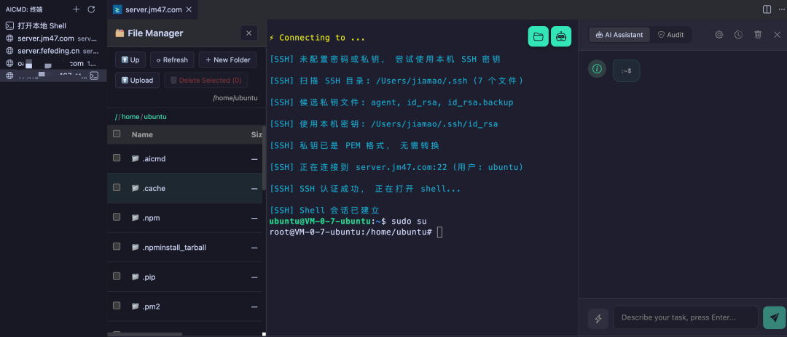

# AICmd Terminal — AI SSH Client & Agent for VS Code

**An AI-powered SSH terminal right inside VS Code.** Connect to remote servers or a local shell, let an AI agent run commands and analyze logs in natural language, transfer files with SFTP / ZMODEM, audit every command, and run batch jobs across servers — without leaving your editor.

[中文文档](https://github.com/fefeding/ai-cmd/blob/main/README.zh.md) · [GitHub 仓库](https://github.com/fefeding/ai-cmd) · [问题反馈](https://github.com/fefeding/ai-cmd/issues)



## Features

| | |
|---|---|
| **SSH & local terminal** | Full xterm.js terminal (256 colors, tabs, auto-reconnect) over `ssh2` / `node-pty` |
| **AI Agent** | OpenAI-compatible function calling (OpenAI / DeepSeek / Qwen / any compatible endpoint): the agent reads terminal output, executes commands and iterates until the task is done |
| **Skills** | Built-in ops playbooks plus your own `/skill` markdown playbooks |
| **File transfer** | SFTP upload / download and `rz` / `sz` ZMODEM with a native Save As dialog |
| **Command audit & replay** | Every AI-executed command is recorded with output, duration and status; timeline, statistics and JSON / CSV export |
| **Log monitoring** | `tail -f` with anomaly detection and AI-powered analysis |
| **Batch operations** | Run one command on multiple servers in parallel and aggregate the results |
| **Jump host & SSH agent forwarding** | Per-connection startup scripts and automatic local SSH agent detection |

> 中文用户：这是 VS Code 里的 **AI SSH 终端 / 运维智能体**，支持 SSH 远程连接、本地 Shell、SFTP 文件传输、命令审计、日志监控与多服务器批量执行；连接配置与桌面版 / CLI 共用 `~/.aicmd`。

## Quick Start

1. Install the extension (from the Marketplace, or `code --install-extension fefeding.vscode-aicmd`), then click the **AICmd** icon in the Activity Bar.
2. Click **Open Local Shell** for a local terminal, or **+** to add an SSH connection (host, port, password / private key). Click a connection to open its terminal.
3. *Optional*: click the robot icon, set an OpenAI-compatible API Key + Base URL, then ask the agent things like *"check disk usage and find the biggest log files"*.

No separate AICmd installation is needed — the distributed extension ships its own front-end and backend, starts the backend on demand on `127.0.0.1`, and stops it when the last panel closes.

## Why AICmd instead of a plain terminal?

- **SSH + AI ops in one place**: a real remote terminal *and* an agent that can act on what it sees, instead of copy-pasting output into a chatbot.
- **Auditable by default**: every command executed by the AI is recorded, with a timeline, statistics and export for review.
- **Fleet-aware**: batch commands, log monitoring and jump-host / agent-forwarding workflows across multiple servers.
- **Shared configuration**: connections, sessions and AI settings live in `~/.aicmd` and are shared with the standalone desktop / CLI AICmd.

## How It Works

```
VSCode Extension Host
  └─ child process: node server.js --port <random free port>   (reuses project root backend, bound to 127.0.0.1)
        ├─ REST API   /api/**
        └─ WebSocket  /ws/terminal
  └─ WebView (iframe → http://127.0.0.1:<port>/)   (same-origin front-end SPA)
```

- The backend runs as a **child process** that reuses the project root's `server.js`, so all features are reused unchanged.
- The WebView loads the front-end through a **same-origin iframe**, which means the API / WebSocket are same-origin — no token or CORS handling is needed.
- The data directory defaults to `~/.aicmd` (overridable via the `aicmd.dataDir` setting) and is **shared with the standalone desktop / CLI AICmd** — the same `connections.json` and other files. A connection added in VSCode is visible in the desktop app, and vice versa.

## Requirements

- VS Code `^1.75.0` or later (Windows / macOS / Linux).
- A published build of the extension already includes its own front-end and backend runtime — **no separate AICmd install is required**. Only source development needs a locally built project, see [Local Development](#local-development).
- Node.js available to launch the backend. The extension locates a `node` binary automatically (see [Environment Variables](#environment-variables)); you normally do not need to set anything.

## Installing the Extension

### From a packaged `.vsix`

```bash
# Build the package first (see Packaging below), then install:
code --install-extension aicmd-terminal-*.vsix
```

### From source (development)

See [Local Development](#local-development). After compiling, press **F5** in VSCode to launch the *Extension Development Host*.

## Usage

### Open the Activity Bar

After activating the extension, an **AICmd** icon appears in the left Activity Bar. Click it to reveal the **Terminal** explorer view, which lists:

- **Open Local Shell** — opens a native local shell (`__local__` connection) inside a VSCode WebView tab.
- **Saved connections** — every connection from `~/.aicmd/connections.json` (shared with the desktop / CLI). SSH connections show a globe icon; local connections show a terminal icon, with the host and username as a description.
- **No connections yet** hint — appears when the connection list is empty; click the **+** button in the view title to add one.

### Open a terminal

You can open a terminal in three ways:

1. **Command Palette**: press `Ctrl/Cmd + Shift + P`, then run **`AICmd: 打开终端`** (command id `aicmd.openTerminal`).
2. **Activity Bar → Terminal view**: click the **Open Local Shell** entry, or click any connection node to open that connection.
3. **Connection node inline action**: hover a connection in the Terminal view and click the terminal icon that appears on the right.

The first launch automatically finds an available port and starts the backend service, then opens the terminal UI in a WebView. Re-opening the same connection appends a number to the tab title (`server 2` / `server 3` …) so multiple sessions stay distinguishable.

### Manage connections

All connection management reuses the same backend and storage as the desktop / CLI app:

- **Add connection**: click the **+** button in the Terminal view title bar (or run `aicmd.addConnection`). A dedicated connection-editor WebView opens; fill in host/port/auth and save.
- **Edit connection**: right-click a connection → **Edit**, or run `aicmd.editConnection`. The same editor WebView opens pre-filled. After saving, the tree refreshes automatically and the editor closes.
- **Delete connection**: right-click a connection → **Delete**, or run `aicmd.deleteConnection`. A confirmation dialog appears; confirming removes the connection via the backend API and refreshes the tree.
- **Refresh**: click the **⟳** button in the view title bar (or run `aicmd.refresh`) to re-read the connection list from the backend.

> The connection editor is the same `ConnectionEditor` component used by the desktop app, so startup scripts and SSH agent forwarding for jump-host workflows are fully supported here too.

### Configure AI

1. In the terminal WebView, click the robot icon (bottom-left sidebar) or the gear icon in the AI chat header.
2. Enter your API Key and Base URL (OpenAI, DeepSeek, Qwen, or any compatible endpoint).
3. Choose a model (default: `gpt-4o-mini`) and save.
4. You can now chat with the AI Agent in natural language — it observes terminal output, runs commands, and iterates until the task is done.

### File download (sz / ZMODEM)

When a terminal session triggers a file download (e.g. `sz file`), the WebView posts a save request to the extension host. VSCode shows a native **Save As** dialog; choose a destination and the file is written to disk.

### Stopping the backend

The backend child process starts on demand and **stops automatically** when all AICmd WebView panels are closed (and no editor panel is open). It also stops when the extension is deactivated. If the backend crashes unexpectedly, all panels close and an error notification is shown; re-open a terminal to restart it.

## Settings

Open **Settings → Extensions → AICmd** (or add to `settings.json`):

| Setting | Type | Default | Description |
|---------|------|---------|-------------|
| `aicmd.dataDir` | string | `~/.aicmd` | Data directory for connections / sessions / AI config / audit logs. Leave empty to share the desktop / CLI `~/.aicmd`. |
| `aicmd.startPort` | number | `9802` | Starting port used when launching the AICmd service inside VSCode. If occupied, the extension scans forward for a free port. |

> Changing `aicmd.dataDir` or `aicmd.startPort` requires reloading the VSCode window to take effect (a notification prompts you to reload).

## Environment Variables

- `AICMD_NODE`: Path to the `node` executable used to launch the backend. By default the extension prefers the VSCode host runtime (Electron), then falls back to nvm / Homebrew / system node. Set this only if auto-detection fails.
- `AICMD_DATA_DIR`: Overrides the data directory for connections / sessions / AI config / audit logs (default `~/.aicmd`). Takes precedence over `aicmd.dataDir` setting.
- `AICMD_AUTH_DISABLED`: Set to `1` to disable local token authentication (rarely needed).

> The local-shell entry uses the special connection id `__local__`, which makes the backend spawn a local terminal session directly.

## Local Development

```bash
# 1. Install dependencies (ensure node-pty is compiled for your local Node)
pnpm install

# 2. Build the front-end + backend (produces dist/)
pnpm build-only

# 3. Install the extension's own build deps and compile the extension host
cd packages/vscode
npm install        # installs esbuild / @types/vscode / vsce
npm run compile    # or `npm run watch` for continuous rebuild
cd ../..

# 4. Press F5 in VSCode to launch the "Extension Development Host"
```

The F5 launch uses a `preLaunchTask` that automatically runs `pnpm build:vscode` (front-end + backend + extension host together).

## Packaging & Publishing

```bash
pnpm build:vscode      # build front-end + backend + extension host
cd packages/vscode
vsce package           # produce a .vsix
vsce publish
```

> The distributed package must include the runtime (`server.js`, `dist/`, `data/skills`, and `node_modules` with the native `node-pty`). Marketplace / Open VSX releases are built by CI, which runs `node scripts/prepare-vscode-runtime.mjs` to copy the runtime into `packages/vscode/runtime/` before packaging. For a local manual build, run that script before `vsce package` — the extension automatically prefers that directory when present.

## Notes

- The extension's backend listens only on `127.0.0.1`, and the WebView loads the front-end from the same origin, so no network exposure or token is required.
- Backend logs are written to the **Output** panel → channel **AICmd** for troubleshooting startup issues.
- The WebView follows your VSCode color theme (light / dark / high-contrast) automatically.

## Support & Feedback

- Questions: the **Q&A** tab on the [Marketplace page](https://marketplace.visualstudio.com/items?itemName=fefeding.vscode-aicmd).
- Bugs & feature requests: [GitHub Issues](https://github.com/fefeding/ai-cmd/issues).
- Chinese documentation: [README.zh.md](https://github.com/fefeding/ai-cmd/blob/main/README.zh.md).
