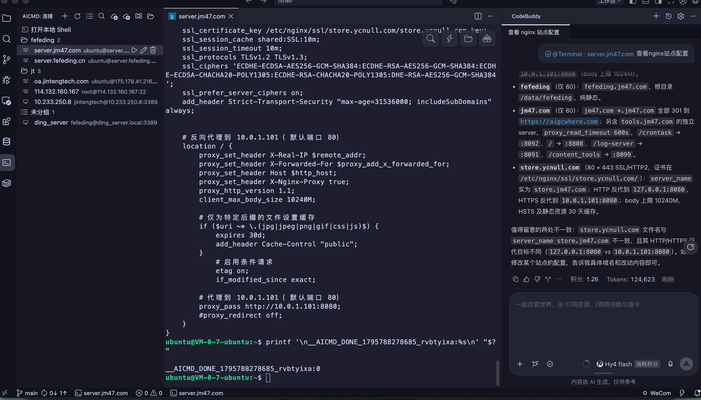

# AICmd — AI SSH / RDP 终端、远程桌面与运维智能体（VS Code 插件）

**一个扩展即可在 VS Code 内使用 AI 驱动的 SSH 终端、Windows 远程桌面和本地 Shell。** 通过 SSH 连接服务器、用 RDP 打开图形化 Windows 桌面、让 AI Agent 用自然语言执行命令并分析日志、传输文件（SFTP / ZMODEM / RDP 剪贴板）、审计每条命令，并对多台服务器批量执行任务——无需离开编辑器。

[English](https://github.com/fefeding/ai-cmd/blob/main/packages/vscode/README.md) · [GitHub 仓库](https://github.com/fefeding/ai-cmd) · [问题反馈](https://github.com/fefeding/ai-cmd/issues)

> 扩展详情页默认展示英文文档；本文件是独立的中文版。扩展内 WebView 界面默认跟随 VS Code / CodeBuddy 的界面语言，也可在侧边栏手动点击「中 / EN」切换。

## 截图



## 功能特性

| | |
|---|---|
| **SSH 与本地终端** | 基于 `ssh2` / `node-pty` 的完整 xterm.js 终端（256 色、多标签页、自动重连） |
| **Windows 远程桌面（RDP）** | 浏览器内 IronRDP-WASM 图形桌面——**无需 guacd、无需本地 RDP 客户端、目标机无需安装第三方软件**。支持鼠标/键盘、全屏、剪贴板同步和文件传输。 |
| **AI Agent** | 兼容 OpenAI function calling（OpenAI / DeepSeek / 通义千问或任意兼容端点）：读取终端输出、执行命令并迭代直到任务完成 |
| **Skills 技能** | 内置运维操作手册，并支持自定义 `/skill` Markdown 技能 |
| **文件传输** | SFTP 上传/下载、`rz` / `sz` ZMODEM 原生另存对话框、RDP CLIPRDR 文件复制——本机复制后在远程桌面按 `Ctrl/Cmd + V`，或使用工具栏上传/下载按钮 |
| **命令审计与回放** | AI 执行的每条命令都记录输出、耗时和状态；支持时间线、统计与 JSON / CSV 导出 |
| **日志监控** | `tail -f` 异常模式检测与 AI 智能分析 |
| **批量操作** | 在多台服务器并行执行同一命令并汇总结果 |
| **跳板机与 SSH Agent 转发** | 每个连接可配置启动脚本，自动发现本机 SSH Agent |
| **连接分组与搜索** | 按分组 / 标签折叠连接树，按名称、主机、用户名、分组、标签快速查找；编辑器只显示必填项，其余配置默认折叠 |
| **连接备份与共享** | 一键导出 / 导入连接 JSON；导出默认剔除凭据适合共享，需备份时可包含凭据 |

连接配置与桌面端 / CLI 共用 `~/.aicmd`。

## 快速开始

1. 安装扩展（从插件市场安装，或执行 `code --install-extension fefeding.vscode-aicmd`），然后点击活动栏中的 **AICmd** 图标。
2. 点击 **打开本地 Shell** 进入本地终端，或点击 **+** 新增连接：
   - **SSH**：填写主机、端口（22）、密码 / 私钥 → 打开终端；
   - **Windows 远程桌面（RDP）**：填写主机、端口（3389）、用户名 / 密码 → 打开图形桌面。
   在视图中点击连接即可打开。
3. *可选*：点击机器人图标，设置兼容 OpenAI 的 API Key + Base URL，然后用自然语言提问，例如“检查磁盘占用并找出最大的日志文件”。

无需单独安装 AICmd——发布包自带前端和后端，按需在 `127.0.0.1` 启动服务，最后一个面板关闭时自动停止。

## 为什么选择 AICmd，而不是普通终端 / RDP 客户端？

- **终端 + 桌面 + AI 运维一体**：真正的远程终端 *和* Windows 图形桌面 *和* 能根据所见内容采取行动的 Agent——无需 mstsc、无需 guacd、无需把输出复制到聊天机器人。
- **轻量远程桌面**：RDP 协议栈在浏览器 WebAssembly 中运行；本地服务只做字节隧道。目标机除 Windows 自带的远程桌面外无需安装任何软件。
- **默认可审计**：AI 执行的每条命令都会被记录，并提供时间线、统计和导出供复查。
- **面向多机**：批量命令、日志监控、跳板机 / Agent 转发工作流覆盖多服务器场景。
- **配置共享**：连接、会话和 AI 设置保存在 `~/.aicmd`，与独立运行的桌面版 / CLI 共享。VS Code 中新增的连接在桌面应用中同样可见，反之亦然。

## 工作原理

```
VSCode 扩展宿主
  └─ 子进程：node server.js --port <随机可用端口>   （复用项目根后端，绑定 127.0.0.1）
        ├─ REST API        /api/**
        ├─ 终端 WS         /ws/terminal   （JSON 协议，ssh2 / node-pty）
        └─ RDP 隧道 WS     /ws/rdp        （二进制 RDCleanPath 字节 → Windows:3389）
  └─ WebView（iframe → http://127.0.0.1:<port>/）   （同源前端 SPA）
        ├─ SSH / 本地 → xterm.js 终端
        └─ RDP        → IronRDP-WASM（浏览器内协议栈 + Canvas 渲染）
```

- 后端作为 **子进程** 复用项目根目录的 `server.js`，因此所有功能原样复用。
- WebView 通过 **同源 iframe** 加载前端，API / WebSocket 同源，不需要 token 或 CORS 处理。
- RDP 基于 **IronRDP-WASM**：协议栈在浏览器内运行，本地服务只把字节转发到配置中的 Windows 主机（忽略客户端声明的目标地址，防止 SSRF），无 `guacd` 守护进程。
- 数据目录默认为 `~/.aicmd`（可通过 `aicmd.dataDir` 设置覆盖），与桌面版 / CLI **共享**同一份 `connections.json` 等文件。

## 环境要求

- VS Code `^1.75.0` 或更高版本（Windows / macOS / Linux）。
- 发布版扩展已自带前端、后端运行时和 RDP WASM 模块——**无需单独安装 AICmd、guacd 或 RDP 客户端**。只有源码开发才需要本地构建，见[本地开发](#本地开发)。
- 需要 Node.js 启动后端。扩展会自动查找 `node`（见[环境变量](#环境变量)），通常无需设置。
- RDP：目标 Windows 需**启用远程桌面**且 TCP 3389 可达，其余由扩展的 WASM 客户端处理。

## 安装扩展

### 从 `.vsix` 安装

```bash
# 先构建安装包（见下方打包说明），然后安装：
code --install-extension aicmd.vsix
```

### 从源码安装（开发）

见[本地开发](#本地开发)。编译后在 VS Code 中按 **F5** 启动 *扩展开发宿主*。

## 使用说明

### 打开活动栏

扩展激活后，左侧活动栏出现 **AICmd** 图标。点击后显示 **连接** 视图，包含：

- **打开本地 Shell** —— 在 VS Code WebView 标签页中打开本地原生 Shell（`__local__` 连接）。
- **已保存的连接** —— 来自 `~/.aicmd/connections.json` 的所有连接（与桌面版 / CLI 共享）。连接按**分组**折叠成文件夹节点（默认按分组，可切换为按标签），点击组名展开；SSH 显示地球图标，**RDP 显示显示器图标**，本地连接显示终端图标；描述中包含主机、用户名和 `#标签`。
- **暂无连接** 提示 —— 连接列表为空时显示；点击视图标题的 **+** 按钮添加。
- 视图标题栏图标依次为：新增 **+**、刷新 **⟳**、会话列表、搜索连接、导出 JSON、导入 JSON、分组方式。

### 打开连接

有四种方式打开终端或远程桌面：

1. **命令面板**：按 `Ctrl/Cmd + Shift + P`，运行 **`AICmd: 打开连接（终端 / 远程桌面）`**（命令 id `aicmd.openTerminal`）。
2. **活动栏 → 连接视图**：点击 **打开本地 Shell** 条目，或展开分组后点击任意连接节点（SSH → 终端，RDP → 图形桌面）。
3. **连接节点内联按钮**：在视图中悬停连接，点击右侧操作图标。
4. **搜索连接**：运行 **`AICmd: 搜索连接（名称 / 分组 / 标签）`**（`aicmd.searchConnection`），输入关键词过滤后选中即打开。

首次打开会自动寻找可用端口、启动后端服务，并在 WebView 中打开界面。重复打开同名连接会追加编号（`server 2` / `server 3` …）以区分多个会话。

### Windows 远程桌面（RDP）

1. 在目标 Windows 上启用 **设置 → 系统 → 远程桌面 → 启用远程桌面**，并确认 TCP 3389 可达。
2. 在 AICmd 中点击 **+** → 连接类型选择 **Windows 远程桌面（RDP）** → 填写主机、端口（默认 **3389**）、用户名、密码；域（域账号填写）和屏幕尺寸（默认 1280×800）在折叠的 **「高级选项（可选）」** 中填写。
3. 点击连接：WebView 中打开图形桌面，支持鼠标/键盘输入和分辨率自适应。

> CredSSP 默认启用。RDP 协议栈完全通过 IronRDP-WASM 在浏览器内运行，无需 guacd 或本地 RDP 客户端。

#### 剪贴板（纯文本）

文本剪贴板同步是**实时的**：在本机复制文本后，在远程桌面内按 `Ctrl/Cmd + V`——粘贴发生时当前本机剪贴板内容会被推送到 RDP 通道（而不是连接建立时抓取的旧值）。远程复制的文本会自动写回本机剪贴板。工具栏的**剪贴板**按钮也可按需推送当前本机文本。

#### 把文件复制到远程桌面

文件传输使用 RDP **CLIPRDR** 通道。以下三种方式都需要**最后在远程桌面内粘贴**，远程才能拉取文件内容：

| 方式 | 步骤 |
|---|---|
| **本机复制文件 + 粘贴（推荐）** | 在系统文件管理器（Finder / 资源管理器）中复制文件，点击远程桌面使其获得焦点，然后在**远程桌面内**按 `Ctrl/Cmd + V`。文件从原生粘贴事件获取并立即发送到远程，一次按键完成，无额外对话框。VS Code 扩展同样支持（WebView 内使用隐藏的可编辑粘贴目标，使跨域 iframe 也能收到文件剪贴板）。 |
| **工具栏上传** | 点击 RDP 工具栏的**上传**（📤）按钮，选择一个或多个文件，然后在**远程桌面内**按 `Ctrl/Cmd + V`（或在目标文件夹右键 → 粘贴）完成传输。界面会弹出提示提醒这一步。 |
| **拖拽** | 把系统里的文件拖到远程桌面画布上，然后在远程桌面内按 `Ctrl/Cmd + V` 粘贴。 |

传输开始后，桌面底部的**文件传输面板**显示每个文件的名称和状态（`等待远程粘贴` → 已传输）。大文件分块流式传输。

> **macOS**：`Cmd + V` 会映射为远程 Windows 的 `Ctrl + V`，Mac 标准复制/粘贴快捷键可直接用。
>
> **VS Code 扩展**：本机复制 → 粘贴同样可用。WebView 使用隐藏的可编辑目标捕获跨域 iframe 内的原生 `paste` 事件（含 `clipboardData.files`），因此**不需要**把工具栏上传当作替代方案。若某个宿主仍阻止文件剪贴板访问，可退回工具栏上传按钮。

#### 从远程桌面复制文件出来

在远程 Windows 中复制文件（例如在资源管理器中），然后点击 RDP 工具栏的**下载**（📥）按钮。远程剪贴板包含文件时按钮自动激活；点击后文件保存到本机**下载**目录。

### 管理连接

所有连接管理复用与桌面版 / CLI 相同的后端和存储：

- **新增连接**：点击视图标题栏的 **+** 按钮（或运行 `aicmd.addConnection`）。打开专用连接编辑 WebView，选择 SSH 或 RDP，填写主机/端口/认证信息并保存。RDP 默认端口 3389、用户名为空；SSH 默认端口 22、用户 `root`。
- **编辑连接**：右键连接 → **编辑**，或运行 `aicmd.editConnection`。打开预填数据的同一编辑器；保存后树自动刷新并关闭编辑器。
- **删除连接**：右键连接 → **删除**，或运行 `aicmd.deleteConnection`。弹出确认对话框；确认后通过后端 API 删除并刷新树。
- **刷新**：点击视图标题栏的 **⟳** 按钮（或运行 `aicmd.refresh`）从后端重新读取连接列表。
- **搜索连接**：点击视图标题栏的放大镜（或运行 `aicmd.searchConnection`），按名称 / 分组 / 标签过滤并直接打开。
- **切换分组方式**：点击视图标题栏的分组图标（或运行 `aicmd.setGroupMode`），选择「按分组折叠」或「按标签折叠」；选择会保存在扩展状态中，下次打开仍生效。
- **导出 JSON**：点击视图标题栏的下载图标（或运行 `aicmd.exportConnections`）→ 选择是否包含凭据 → 保存 `.json`。默认剔除密码 / 私钥，适合团队共享；包含凭据的备份请仅限个人使用并妥善保管。
- **导入 JSON**：点击视图标题栏的上传图标（或运行 `aicmd.importConnections`）→ 选择 JSON 文件并确认 → 同名连接按新配置覆盖、其余连接保持不变，完成后提示新增 / 覆盖 / 跳过数量。导入后会重新生成连接 ID，凭据按本地规则重新加密存储。

> 连接编辑器与桌面应用使用同一个 `ConnectionEditor` 组件，默认只显示名称、类型、主机 / 端口、用户名和认证方式；**分组与标签、高级选项（目标平台 / RDP 域和分辨率）、连接后自动执行脚本、端口转发、保活、终端外观、代理设置**均折叠在可选卡片中（已有配置会在编辑时自动展开并显示标记）。因此 SSH 启动脚本和跳板机 SSH Agent 转发、以及 SSH / RDP 的**代理设置**（直连、系统代理或自定义 HTTP / HTTPS / SOCKS4 / SOCKS5，详见[代理配置指南](../../docs/proxy.md)）仍然完整支持。扩展与桌面版共用后端，代理由本机后端服务建立，不受浏览器代理设置影响。

### 配置 AI

1. 在终端 WebView 中点击侧边栏左下角的机器人图标，或 AI 聊天头部的齿轮图标。
2. 输入 API Key 和 Base URL（OpenAI、DeepSeek、通义千问或任意兼容端点）。
3. 选择模型（默认 `gpt-4o-mini`）并保存。
4. 现在可以用自然语言与 AI Agent 对话——它观察终端输出、执行命令并迭代直到任务完成。

### 把终端添加到编辑器的 AI 对话

在已连接的 AICmd 终端里右键选择**「添加到 AI 对话」**：

1. 选中的终端文本（没有选中时取最近 200 行输出）作为 `@Terminal` 上下文插入输入框，**不会自动发送**。
2. 当前终端被独占绑定到这次对话，VSCode 状态栏出现终端指示器，点击即可解除绑定。
3. 当前终端的通道信息以 `[channel]`（会话 / 连接 / 机器）、`[bridge]`（一次性桥接命令）、`[tools]`、`[valid]` 形式随引用一起带入对话。**不会写用户级 MCP 配置**，插件禁用或解除绑定后不会留下任何注入。
4. AI 获得 AICmd 工具。现在可以直接问“查看这台机器的 nginx 配置”，AI 会先确认机器，再读取屏幕、执行命令并汇总结果。

**工具选择**：优先使用宿主已注册的工具——原生 VSCode 为 `aicmd_sessionInfo`、`aicmd_sessionRead`、`aicmd_sessionExec`、`aicmd_sessionOutput`、`aicmd_sessionInterrupt`、`aicmd_sessionDetach`（输入框可用 `#aicmdExec` 引用）；其它编辑器为 `session_info`、`session_read`、`session_exec`、`session_output`、`session_interrupt`、`session_detach`。输出过长时分段读取，不需要重跑命令。

**一次性桥接**：若当前 Agent 看不到上述工具（例如 CodeBuddy IDE 的 Agent 会过滤扩展工具），直接按引用中的 `[bridge]` 执行，例如：

```bash
node "<扩展目录>/dist/mcp.js" --call session_exec '{"command":"uptime"}'
```

它只作用于当前绑定的终端，解除绑定后返回 `NO_BINDING`；无需改 MCP 配置，也不要手写 HTTP 请求。

- Trae：通过 `workbench.action.chat.icube.open` 把 terminalPayload 附加到 Cascade。
- 原生 VSCode 1.105+：把已绑定终端作为以连接名命名的单个文件引用加入输入框，没有额外话述、不自动发送；旧版本退回工具引用或文本快照。
- Cursor、Windsurf：`workbench.action.chat.open` 预填输入框，不会自动发送。
- Cline、Continue、Roo Code：聚焦插件输入框并粘贴快照，不会自动发送。
- 原生 VSCode 只有在上述 AI 对话插件处于激活状态时才显示菜单；插件后启动也会自动出现，无需重开终端。
- 快照在点击菜单时抓取，再次点击即可刷新。
- 通义灵码：在智能体模式下使用引用中的工具名或 `[bridge]` 命令；其 MCP 服务上限为 10 个，本插件只占一个临时入口、不写配置文件。

**安全边界**：一次只绑定一个终端；命令写入用户可见的交互式 shell 并记入审计；危险命令会被拦截；工具本身不接收会话 / 连接 id，通道信息只随本次引用带入且解绑即失效。可以随时在终端按 Ctrl+C 中断，或点击状态栏终端指示器解除绑定。

### 文件下载（sz / ZMODEM）

当终端会话触发文件下载（例如 `sz file`）时，WebView 向扩展宿主发送保存请求。VS Code 显示原生**另存为**对话框，选择目标位置后文件写入磁盘。

### 停止后端

后端子进程按需启动，当所有 AICmd WebView 面板关闭（且没有编辑器面板打开）时**自动停止**；扩展停用时也会停止。若后端意外崩溃，所有面板关闭并显示错误通知；重新打开连接即可重启。

## 设置

打开 **设置 → 扩展 → AICmd**（或写入 `settings.json`）：

| 设置项 | 类型 | 默认值 | 说明 |
|--------|------|--------|------|
| `aicmd.dataDir` | string | `~/.aicmd` | 连接 / 会话 / AI 配置 / 审计日志的数据目录。留空则复用桌面版 / CLI 的 `~/.aicmd`。 |
| `aicmd.startPort` | number | `9802` | 在 VS Code 内启动 AICmd 服务使用的起始端口；被占用时自动向后寻找可用端口。 |

> 修改 `aicmd.dataDir` 或 `aicmd.startPort` 需要重新加载 VS Code 窗口才生效（会弹出提示）。

## 环境变量

- `AICMD_NODE`：用于启动后端的 `node` 可执行文件路径。默认优先使用 VS Code 宿主运行时（Electron），再回退到 nvm / Homebrew / 系统 Node。仅自动检测失败时才设置。
- `AICMD_DATA_DIR`：覆盖连接 / 会话 / AI 配置 / 审计日志的数据目录（默认 `~/.aicmd`）。优先级高于 `aicmd.dataDir` 设置。
- `AICMD_AUTH_DISABLED`：设为 `1` 可禁用本地令牌认证（很少需要）。

> 本地 Shell 条目使用特殊连接 id `__local__`，使后端直接启动本地终端会话。

## 本地开发

```bash
# 1. 安装依赖（确保 node-pty 针对本地 Node 编译）
pnpm install

# 2. 构建前端 + 后端（生成 dist/）
pnpm build-only

# 3. 安装扩展自身的构建依赖并编译扩展宿主
cd packages/vscode
npm install        # 安装 esbuild / @types/vscode / vsce
npm run compile    # 或 `npm run watch` 持续重编译
cd ../..

# 4. 在 VS Code 中按 F5 启动“扩展开发宿主”
```

F5 启动会使用 `preLaunchTask` 自动运行 `pnpm build:vscode`（前端 + 后端 + 扩展宿主一起构建）。

## 打包与发布

```bash
pnpm build:vscode      # 构建前端 + 后端 + 扩展宿主
node scripts/prepare-vscode-runtime.mjs
cd packages/vscode
vsce package           # 生成 .vsix
vsce publish
```

> 发布包必须包含运行时（`server.js`、含 `rdp_client_bg.wasm` 的 `dist/`、`data/skills`，以及带原生 `node-pty` 的 `node_modules`）。插件市场 / Open VSX 由 CI 构建：先运行 `node scripts/prepare-vscode-runtime.mjs` 把运行时复制到 `packages/vscode/runtime/`，再打包。本地手动打包也需先运行该脚本；存在该目录时扩展会优先使用它。

## 注意事项

- 后端只监听 `127.0.0.1`，WebView 从同源加载前端，因此没有网络暴露，也不需要令牌。
- RDP 目标地址始终取自已保存的连接配置，绝不信任浏览器客户端——恶意页面无法把隧道重定向到任意主机。
- 后端日志写入 **输出** 面板 → **AICmd** 频道，便于排查启动问题。
- WebView 自动跟随 VS Code 颜色主题（浅色 / 深色 / 高对比度）；界面语言跟随 VS Code / CodeBuddy 的界面语言（也可在侧边栏手动切换）。

## 支持与反馈

- 问题：插件市场页面上的 **Q&A** 标签页。
- Bug 与功能请求：[GitHub Issues](https://github.com/fefeding/ai-cmd/issues)。
- 英文文档：[README.md](https://github.com/fefeding/ai-cmd/blob/main/packages/vscode/README.md)。
